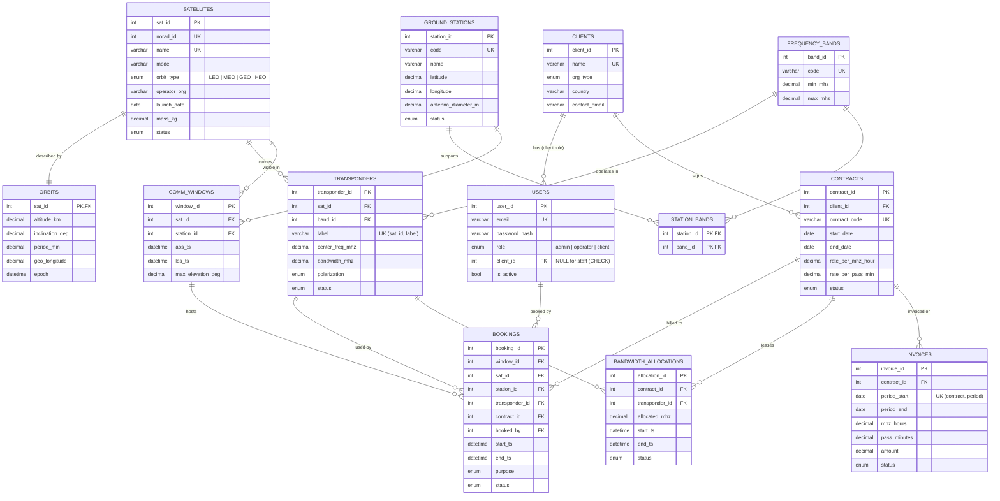
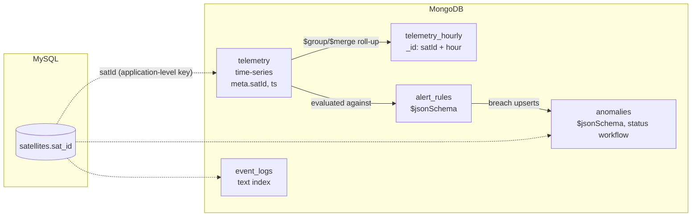

# SCMS – Entity-Relationship Diagram

GitHub, VS Code (with a Mermaid extension) and https://mermaid.live render this diagram.

`AUDIT_LOG` is not shown. It is a standalone, trigger-written table with no foreign keys, so audit history survives deletions.

## MongoDB collections (document model)

